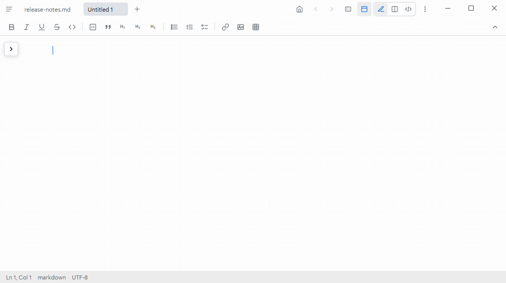
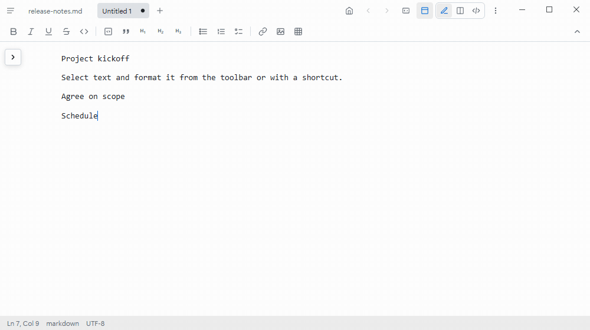
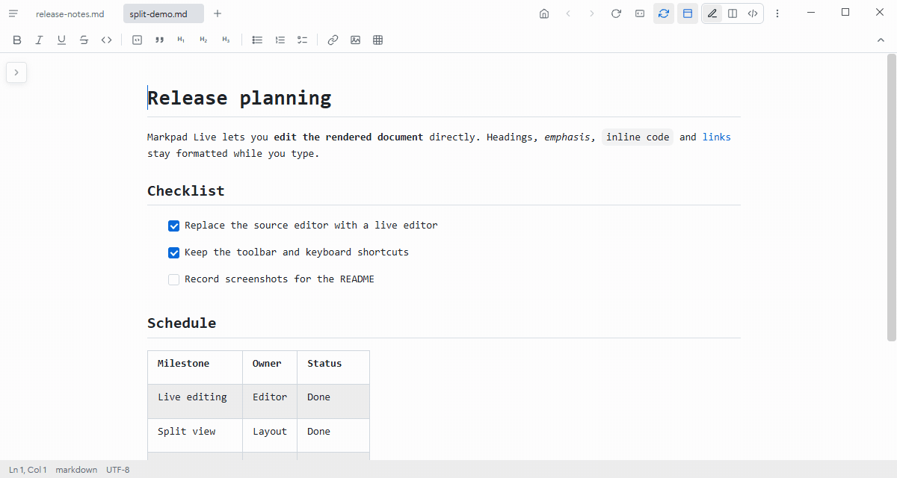
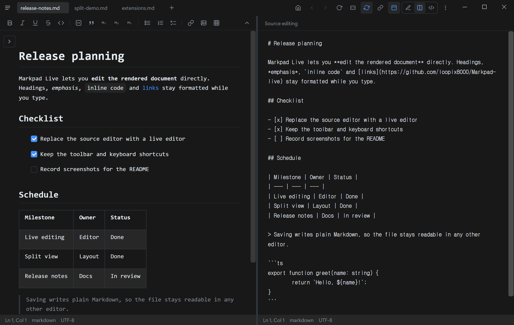
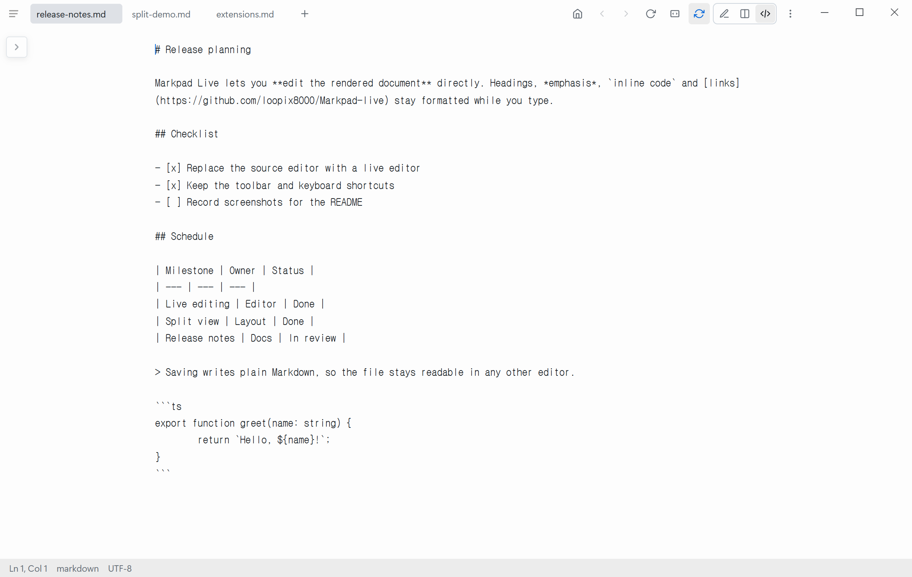
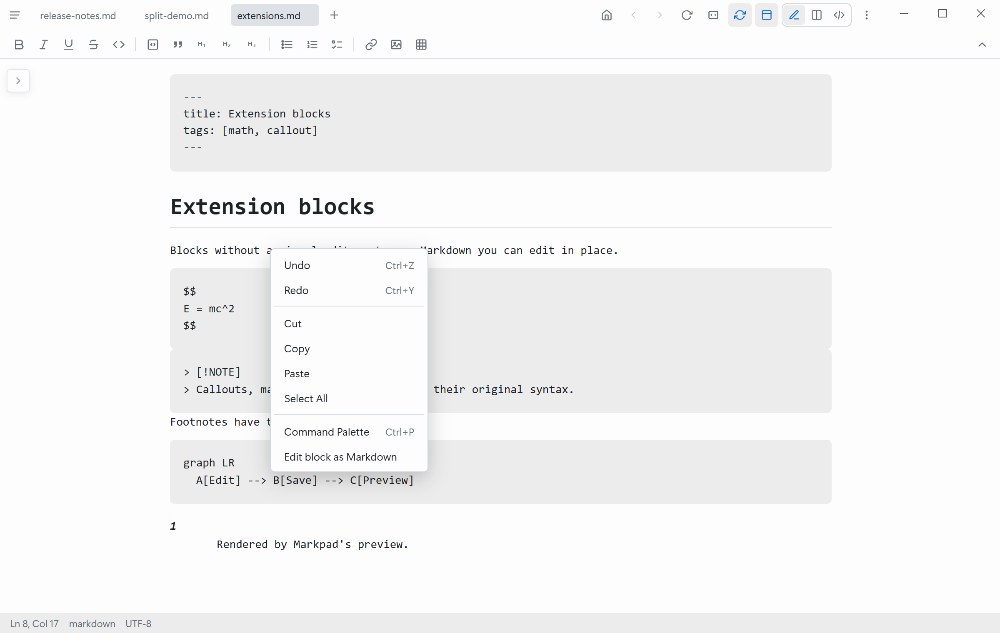

<div align="center">
  
  <h1>Markpad Live</h1>
  <p><b>위지윅 Markdown 에디터를 갖춘 Markpad</b></p>
  <p>렌더링된 문서에 바로 입력하고, 일반 Markdown으로 저장합니다.</p>
  <a href="#소스에서-빌드하기">소스에서 빌드하기</a> · <a href="https://github.com/sftwrdotdev/Markpad#readme">Markpad README</a> · <a href="README.md">English</a> · <a href="README.zh-CN.md">简体中文</a>
</div>

<br />



Markpad Live는 [Markpad](https://github.com/sftwrdotdev/Markpad)의 포크로, Monaco 원문 편집기를 [Milkdown](https://milkdown.dev) 기반의 라이브 편집기로 바꿨습니다. 읽기 화면, 탭과 창, 세션 복원, 목차, Zen 모드, 테마, 글꼴, 내보내기와 인쇄는 Markpad와 같으며 **[Markpad README](https://github.com/sftwrdotdev/Markpad#readme)**에서 설명합니다. 이 문서는 편집기만 다룹니다.

## 렌더링된 문서에서 편집하기

Markdown 문법을 입력하면 블록이 바로 서식을 갖춥니다. `#`은 제목, `**텍스트**`는 굵게, `- [ ]`는 할 일, `>`는 인용이 되고, ` ``` ` 뒤에 <kbd>Enter</kbd>를 누르면 코드 블록이 열립니다. 할 일은 체크박스를 눌러 완료로 표시합니다.

저장할 때는 Markpad의 파일·인코딩 처리를 그대로 거쳐 Markdown으로 기록하므로, 다른 편집기에서도 그대로 읽을 수 있습니다. 손대지 않은 블록은 setext 제목, 참조 정의, 줄바꿈 문자까지 원래 표기를 유지합니다.

## 툴바와 단축키로 서식 적용하기



텍스트를 선택한 뒤 서식 툴바를 누르거나 단축키를 사용합니다. 버튼에 마우스를 올리면 단축키가 표시됩니다.

| 동작 | 단축키 |
| --- | --- |
| 굵게, 기울임, 밑줄 | <kbd>Ctrl</kbd>+<kbd>B</kbd>, <kbd>Ctrl</kbd>+<kbd>I</kbd>, <kbd>Ctrl</kbd>+<kbd>U</kbd> |
| 취소선, 인라인 코드 | <kbd>Ctrl</kbd>+<kbd>Shift</kbd>+<kbd>X</kbd>, <kbd>Ctrl</kbd>+<kbd>Shift</kbd>+<kbd>E</kbd> |
| 제목 1~3 | <kbd>Ctrl</kbd>+<kbd>1</kbd>~<kbd>Ctrl</kbd>+<kbd>3</kbd> |
| 번호 목록, 글머리 기호 목록, 할 일 목록 | <kbd>Ctrl</kbd>+<kbd>Shift</kbd>+<kbd>7</kbd>, <kbd>8</kbd>, <kbd>9</kbd> |
| 인용, 코드 블록 | <kbd>Ctrl</kbd>+<kbd>Shift</kbd>+<kbd>.</kbd>, <kbd>Ctrl</kbd>+<kbd>Shift</kbd>+<kbd>F</kbd> |
| 링크 | <kbd>Ctrl</kbd>+<kbd>K</kbd> |
| 표 삽입 | <kbd>Ctrl</kbd>+<kbd>Alt</kbd>+<kbd>T</kbd> |
| 표 아래·위에 행 추가 | <kbd>Ctrl</kbd>+<kbd>Enter</kbd>, <kbd>Ctrl</kbd>+<kbd>Shift</kbd>+<kbd>Enter</kbd> |
| 표 열 추가·삭제 | <kbd>Ctrl</kbd>+<kbd>Shift</kbd>+<kbd>C</kbd>, <kbd>Ctrl</kbd>+<kbd>Shift</kbd>+<kbd>Backspace</kbd> |

macOS에서는 <kbd>Ctrl</kbd> 대신 <kbd>Cmd</kbd>를 씁니다. 표 안에서는 <kbd>Tab</kbd>으로 다음 셀로 이동합니다.

## 라이브 편집, 분할 보기, 원문 편집



오른쪽 위의 버튼 세 개로 현재 탭을 어떻게 편집할지 고릅니다.

| 보기 | 편집하는 대상 |
| --- | --- |
| 라이브 편집 | 렌더링된 문서 |
| 분할 보기 | 왼쪽은 렌더링된 문서, 오른쪽은 Markdown 원문. 한쪽에서 고치면 다른 쪽에도 반영됩니다. |
| 원문 편집 | Markdown 원문 |

<kbd>Ctrl</kbd>+<kbd>E</kbd>는 라이브 편집과 원문 편집을 오갑니다. 분할 보기에서는 커서를 반대쪽 창으로 옮깁니다.

라이브 편집과 원문 편집은 문서를 읽기 좋은 폭으로 보여 줍니다. 제목 표시줄의 **전체 너비** 버튼을 누르면 창 너비 전체로 펼칩니다.

<p align="center">
  
  
</p>

## Markdown 원문으로 남는 블록



GitHub 스타일 표, 할 일 목록, 취소선, 각주는 전용 편집 블록으로 표시됩니다. YAML front matter, 수식, 콜아웃, 위키링크, 참조 정의, 편집기가 표시할 수 없는 HTML은 Markdown 텍스트로 남아 그 자리에서 고칠 수 있습니다. Mermaid 다이어그램은 편집 가능한 코드 블록으로 남습니다. 렌더링된 모습을 보려면 **설정 › 기존 파일 열기 모드**를 **미리보기**로 바꾸고 파일을 다시 여세요.

편집기가 자동으로 변환해 버리는 문법을 새로 입력하려면, 블록에서 우클릭한 뒤 **블록 원문 편집**(Edit block as Markdown)을 고르세요.

## 이미지

이미지는 Markdown으로 직접 입력하거나, 붙여 넣거나, 파일 탐색기에서 끌어다 놓을 수 있습니다. 저장된 문서는 붙여 넣은 이미지를 설정된 이미지 폴더에 저장하고, 제목 없는 문서는 이미지 데이터를 Markdown 안에 직접 넣습니다. 이미지를 더블클릭하면 경로를 바꿀 수 있습니다.

## 알아둘 점

- 서식이 있는 블록을 고치면 편집기가 Markdown을 다시 쓰면서 표기가 바뀔 수 있습니다. 예를 들어 목록 기호 `-`가 `*`로 바뀝니다. 원문을 정확히 그대로 두려면 고치지 않고 열었다 닫으세요.
- Markpad의 Monaco 편집기에 있던 Vim 모드, 미니맵, 코드 자동 완성은 제공하지 않습니다.
- Markdown이 아닌 파일은 일반 텍스트로 열립니다.

## 소스에서 빌드하기

앱은 Tauri 2와 Rust로 만들었고, 화면은 SvelteKit, Svelte 5, TypeScript로 구현했습니다. 편집기는 CommonMark·GFM 프리셋을 쓰는 Milkdown Kit 7.23입니다.

Node.js 24, Rust stable, 운영체제별 [Tauri 사전 요구 사항](https://v2.tauri.app/start/prerequisites/)을 설치한 뒤 실행합니다.

```sh
npm ci
npm run tauri dev
```

검사와 빌드:

```sh
npm run check
npm run lint
npm test
npm run test:vitest
cargo test --manifest-path src-tauri/Cargo.toml
npm run tauri build
```

업데이트 서명 없이 로컬 설치 파일을 만들려면 Tauri 설정 덮어쓰기 `{"bundle":{"createUpdaterArtifacts":false}}`를 지정해 빌드하세요. 배포와 서명은 [RELEASING.md](RELEASING.md)에서 다룹니다.

## 출처와 라이선스

Markpad Live는 Alec Ames와 기여자들이 만든 [Markpad](https://github.com/sftwrdotdev/Markpad)의 포크입니다. 원본의 BSD 3-Clause 라이선스와 저작권 고지를 [LICENSE](LICENSE)에 그대로 유지합니다. 편집기는 MIT 라이선스의 [Milkdown](https://github.com/Milkdown/milkdown)을 사용합니다.
