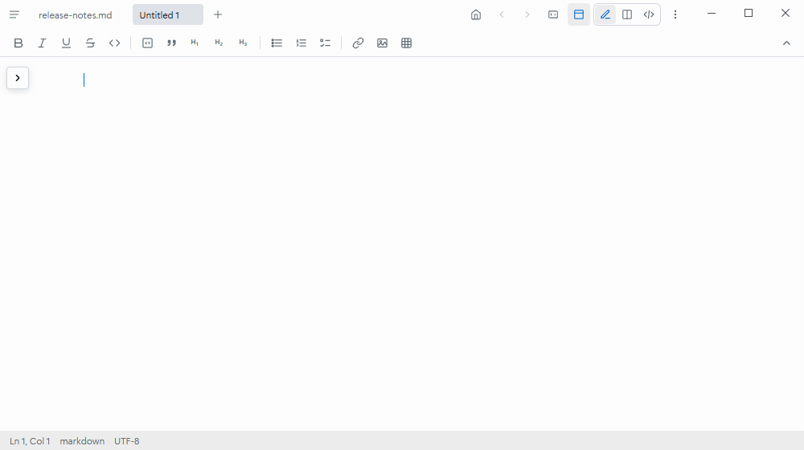
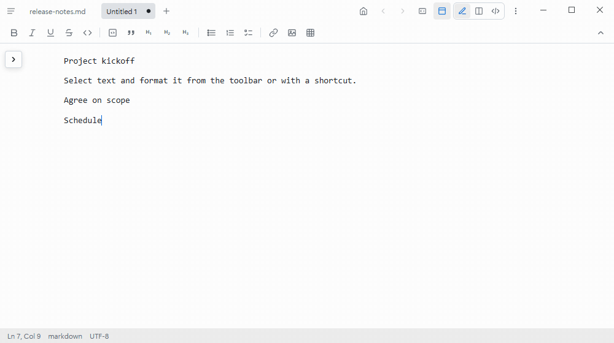
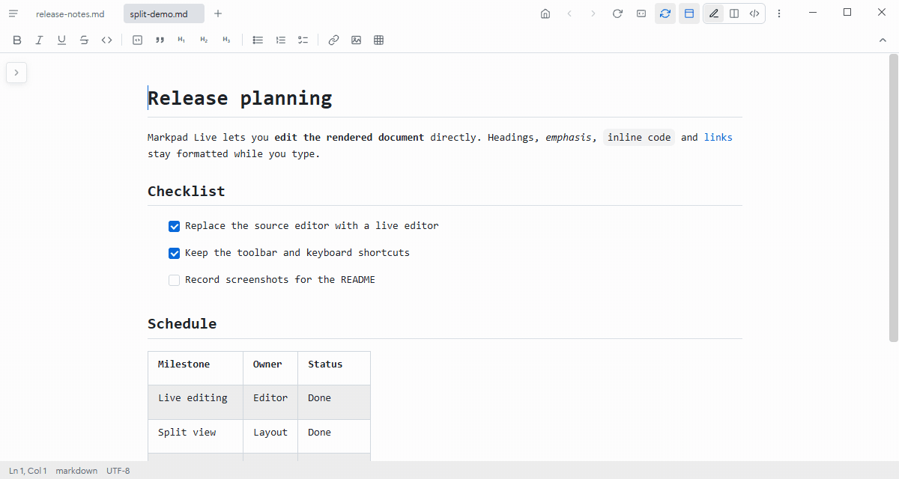
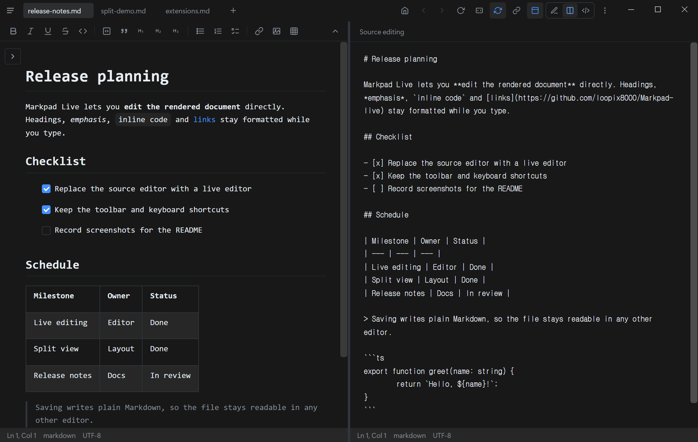
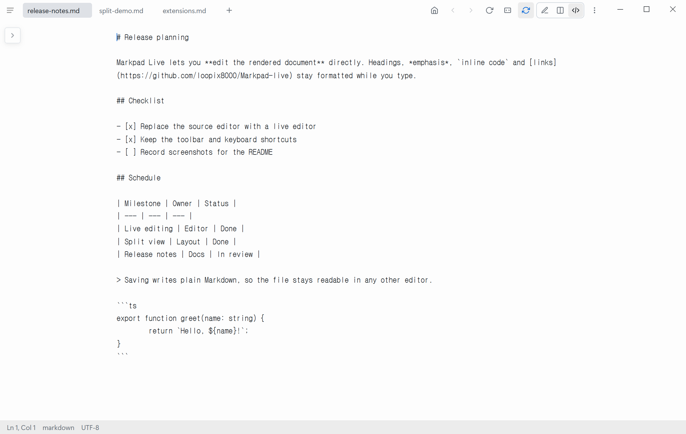
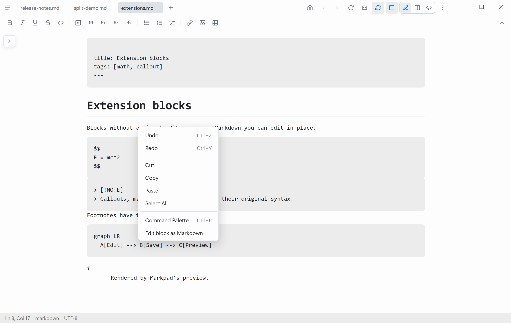

<div align="center">
  
  <h1>Markpad Live</h1>
  <p><b>Markpad with a WYSIWYG Markdown editor.</b></p>
  <p>Type in the rendered document. Save plain Markdown.</p>
  <a href="#build-from-source">Build from source</a> · <a href="https://github.com/sftwrdotdev/Markpad#readme">Markpad README</a> · <a href="README.ko.md">한국어</a> · <a href="README.zh-CN.md">简体中文</a>
</div>

<br />



Markpad Live is a fork of [Markpad](https://github.com/sftwrdotdev/Markpad) that replaces its Monaco source editor with a live editor built on [Milkdown](https://milkdown.dev). Reading, tabs and windows, sessions, the outline, Zen mode, themes, fonts, export and printing work as in Markpad. They are described in the **[Markpad README](https://github.com/sftwrdotdev/Markpad#readme)**. This page covers the editor.

## Edit the rendered document

Type Markdown and each block takes its formatting as you write it. `#` starts a heading, `**text**` becomes bold, `- [ ]` starts a task, `>` starts a quote and ` ``` ` followed by <kbd>Enter</kbd> opens a code block. Click a checkbox to tick a task.

Saving writes Markdown through Markpad's own file and encoding handling, so the file stays readable in any other editor. Blocks you have not touched keep their original spelling, including setext headings, reference definitions and line endings.

## Format with the toolbar or the keyboard



Select text and use the formatting toolbar, or press its shortcut. Hover a button to see the shortcut.

| Action | Shortcut |
| --- | --- |
| Bold, italic, underline | <kbd>Ctrl</kbd>+<kbd>B</kbd>, <kbd>Ctrl</kbd>+<kbd>I</kbd>, <kbd>Ctrl</kbd>+<kbd>U</kbd> |
| Strikethrough, inline code | <kbd>Ctrl</kbd>+<kbd>Shift</kbd>+<kbd>X</kbd>, <kbd>Ctrl</kbd>+<kbd>Shift</kbd>+<kbd>E</kbd> |
| Heading 1 to 3 | <kbd>Ctrl</kbd>+<kbd>1</kbd> to <kbd>Ctrl</kbd>+<kbd>3</kbd> |
| Numbered, bulleted, task list | <kbd>Ctrl</kbd>+<kbd>Shift</kbd>+<kbd>7</kbd>, <kbd>8</kbd>, <kbd>9</kbd> |
| Quote, code block | <kbd>Ctrl</kbd>+<kbd>Shift</kbd>+<kbd>.</kbd>, <kbd>Ctrl</kbd>+<kbd>Shift</kbd>+<kbd>F</kbd> |
| Link | <kbd>Ctrl</kbd>+<kbd>K</kbd> |
| Insert table | <kbd>Ctrl</kbd>+<kbd>Alt</kbd>+<kbd>T</kbd> |
| Add a table row below or above | <kbd>Ctrl</kbd>+<kbd>Enter</kbd>, <kbd>Ctrl</kbd>+<kbd>Shift</kbd>+<kbd>Enter</kbd> |
| Add or delete a table column | <kbd>Ctrl</kbd>+<kbd>Shift</kbd>+<kbd>C</kbd>, <kbd>Ctrl</kbd>+<kbd>Shift</kbd>+<kbd>Backspace</kbd> |

On macOS, use <kbd>Cmd</kbd> in place of <kbd>Ctrl</kbd>. In a table, <kbd>Tab</kbd> moves to the next cell.

## Live, split and source views



The three buttons at the top right choose how you edit the current tab.

| View | What you edit |
| --- | --- |
| Live editing | The rendered document. |
| Split view | The rendered document on the left and its Markdown source on the right. An edit in either pane appears in the other. |
| Source editing | The Markdown source. |

<kbd>Ctrl</kbd>+<kbd>E</kbd> switches between live and source editing. In split view it moves the cursor to the other pane.

Live and source editing keep the document in a readable column. The **Full Width** button in the title bar spreads it across the window.

<p align="center">
  
  
</p>

## Blocks the editor keeps as Markdown



GitHub-style tables, task lists, strikethrough and footnotes have their own editor blocks. YAML front matter, math, callouts, wikilinks, reference definitions and HTML that the editor cannot show stay as Markdown text you can edit in place. A Mermaid diagram stays an editable code block. To see how these render, set **Settings › Open existing files in** to **Preview** and open the file again.

To type new syntax that the editor would otherwise convert, right-click a block and choose **Edit block as Markdown**.

## Images

Type an image in Markdown, paste one, or drop one from your file manager. A saved document stores pasted images in its configured image directory. An untitled document embeds the image data in the Markdown. Double-click an image to change its path.

## Things to know

- Editing a formatted block can change its Markdown spelling when the editor writes it back. For example, `-` list markers become `*`. Open and close a document without editing to keep its source exactly as it was.
- Vim mode, the minimap and code completion from Markpad's Monaco editor are not available.
- Files that are not Markdown open as plain text.

## Build from source

The app uses Tauri 2 and Rust, with SvelteKit, Svelte 5 and TypeScript for the interface. The editor uses Milkdown Kit 7.23 with the CommonMark and GFM presets.

Install Node.js 24, Rust stable and the [Tauri prerequisites](https://v2.tauri.app/start/prerequisites/) for your OS, then run:

```sh
npm ci
npm run tauri dev
```

To check and build:

```sh
npm run check
npm run lint
npm test
npm run test:vitest
cargo test --manifest-path src-tauri/Cargo.toml
npm run tauri build
```

For a local installer without updater signing, build with the Tauri configuration override `{"bundle":{"createUpdaterArtifacts":false}}`. Distribution and signing are covered in [RELEASING.md](RELEASING.md).

## Origin and license

Markpad Live is a fork of [Markpad](https://github.com/sftwrdotdev/Markpad) by Alec Ames and contributors. It keeps the original BSD 3-Clause license and copyright notice in [LICENSE](LICENSE). The editor uses the MIT-licensed [Milkdown](https://github.com/Milkdown/milkdown).
