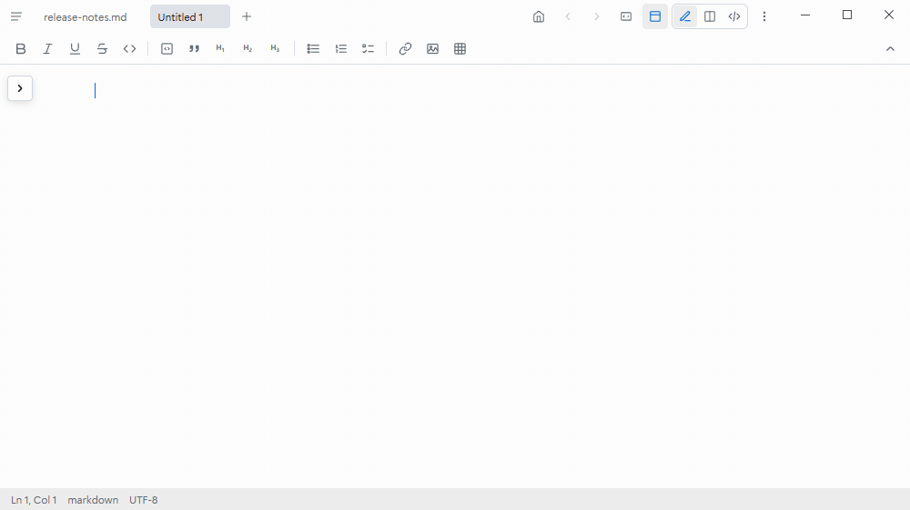
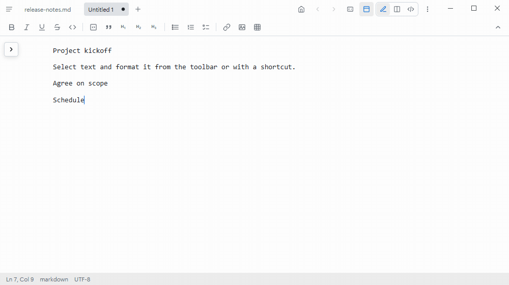
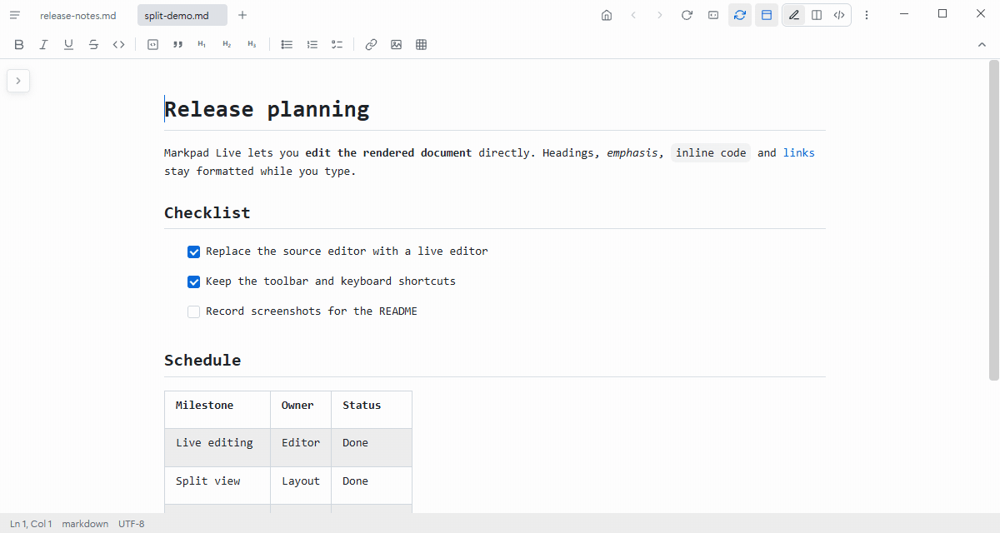
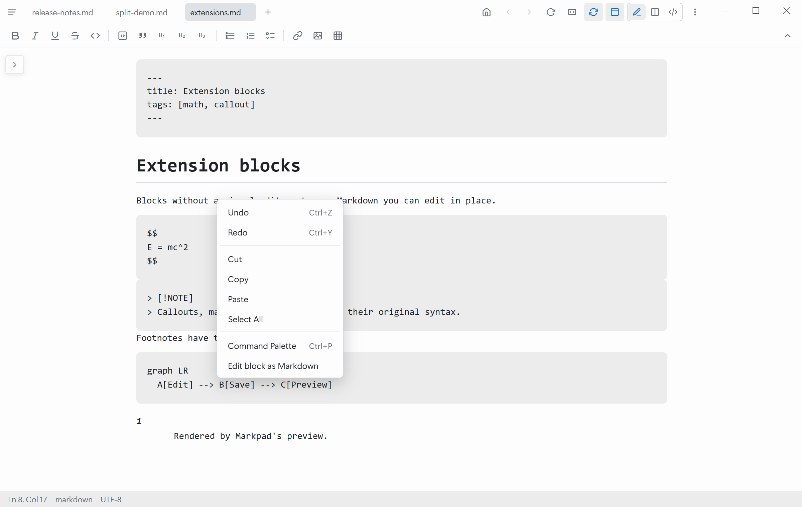

<div align="center">
  
  <h1>Markpad Live</h1>
  <p><b>带所见即所得 Markdown 编辑器的 Markpad。</b></p>
  <p>直接在渲染后的文档中输入，保存为纯 Markdown。</p>
  <a href="https://github.com/sftwrdotdev/Markpad/blob/HEAD/README.zh-CN.md">Markpad 中文说明</a> · <a href="README.md">English</a> · <a href="README.ko.md">한국어</a>
</div>

<br />



Markpad Live 是 [Markpad](https://github.com/sftwrdotdev/Markpad) 的分支，用基于 [Milkdown](https://milkdown.dev) 的实时编辑器取代了 Monaco 源码编辑器。阅读视图、标签页与窗口、会话恢复、目录、Zen 模式、主题、字体、导出和打印与 Markpad 相同，请参阅 **[Markpad 中文说明](https://github.com/sftwrdotdev/Markpad/blob/HEAD/README.zh-CN.md)**。本页只介绍编辑器。

## 在渲染后的文档中编辑

输入 Markdown 语法后，段落会立即显示为对应格式：`#` 开始标题，`**文本**` 变为粗体，`- [ ]` 开始任务，`>` 开始引用，` ``` ` 后按 <kbd>Enter</kbd> 开始代码块。点击复选框即可勾选任务。保存时写回 Markdown，未改动的段落保持原有写法。

## 工具栏与快捷键



选中文字后点击格式工具栏按钮或按对应快捷键。将鼠标悬停在按钮上可查看快捷键。在表格中按 <kbd>Tab</kbd> 移到下一个单元格，按 <kbd>Ctrl</kbd>+<kbd>Enter</kbd> 在下方添加一行。快捷键列表见 [README](README.md#format-with-the-toolbar-or-the-keyboard)。

## 实时、分栏与源码视图



右上角的三个按钮分别是实时编辑、分栏视图和源码编辑。分栏视图左侧为渲染后的文档，右侧为 Markdown 源码，任一侧的修改都会同步到另一侧。<kbd>Ctrl</kbd>+<kbd>E</kbd> 在实时编辑与源码编辑之间切换；在分栏视图中则把光标移到另一侧。实时编辑和源码编辑默认以适合阅读的宽度显示文档，点击标题栏的“全宽”按钮可铺满窗口。

## 以 Markdown 原文保留的块



表格、任务列表、删除线和脚注有对应的可视化编辑块。YAML front matter、数学公式、标注块、Wiki 链接、引用定义以及无法显示的 HTML 以 Markdown 原文保留，可直接修改。要输入会被编辑器自动转换的语法，可右键点击段落并选择 **Edit block as Markdown**。

## 注意事项

- 编辑带格式的段落时，编辑器写回的 Markdown 写法可能改变，例如列表标记 `-` 会变为 `*`。
- 不提供 Monaco 编辑器的 Vim 模式、缩略图和代码补全。

构建步骤见 [README](README.md#build-from-source)。原项目的 BSD 3-Clause 许可证和版权声明保存在 [LICENSE](LICENSE)。
